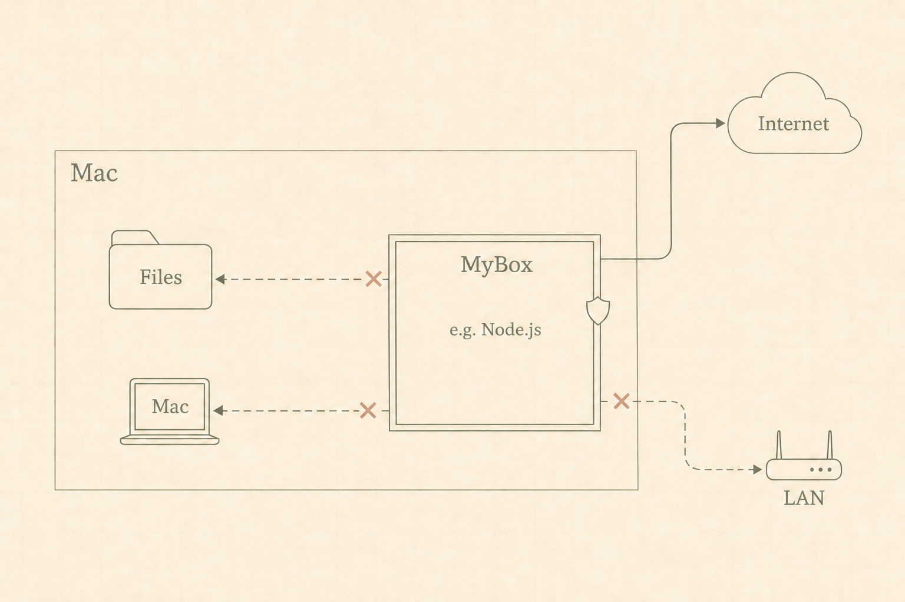
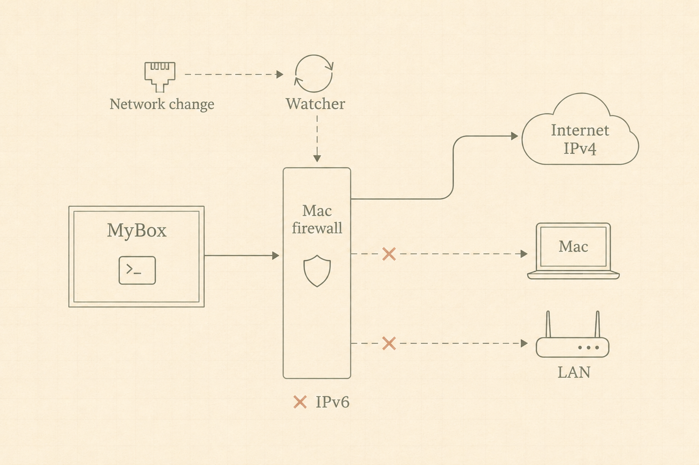
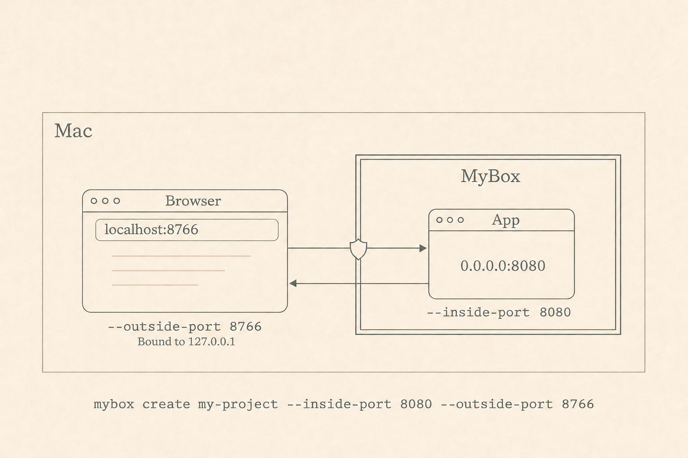
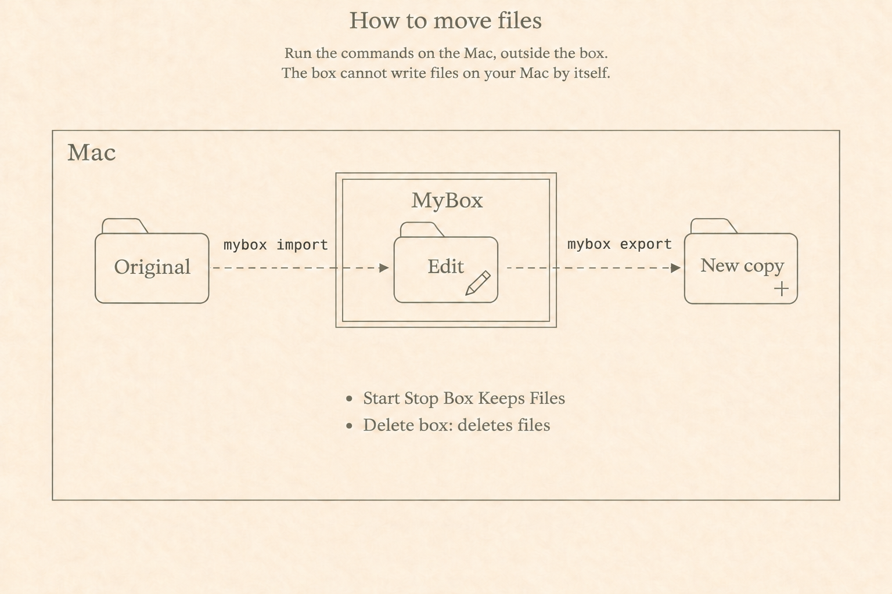

# MyBox

New boxes start with **Debian 13 (Trixie) Slim** from the image `docker.io/library/debian:trixie-slim`.
Copies retain the source box's Linux filesystem and installed tools.









A small Swift CLI around Apple's `container` CLI. Each box keeps Linux and its
project files on the container's default storage. Source files live in
`/workspace` inside Linux.

This development version includes PF protection before box startup. A trusted
helper creates the bridge before MyBox starts the development VM. The live PF
and CLI integration tests passed on 4 November 2026 before the watcher update.
Automatic network-change detection is installed and passed all 12 live interface-change checks.
After an actual Mac reboot, automatic firewall recovery and all 14 CLI checks passed.
A corrected test rerun also confirmed that box operations preserved the main PF/NAT rules.
The added connection checks passed after reboot. A fresh box could not reach the
tested Mac IPv4/IPv6 listeners or the router's IPv4 TCP port. Internet/DNS continued to work.
Detection does not guarantee zero exposure time.
See [the recorded results and limits](project.md#current-implementation-trusted-helper-and-pf).

There are three separate programs:

- `mybox` manages boxes, shells, and file transfers as your normal user.
- `mybox-firewall-manager` watches network changes and manages MyBox firewall rules with administrator rights.
- `mybox-port-forwarder` forwards TCP traffic from the Mac to a box as your normal user.

The firewall manager does not contain the box-management commands.
Run `mybox setup-network` after this update to install firewall protocol version 3 for live port changes.
The update retains saved firewall policy and box data.

## Development setup

Requires the existing Apple `container` CLI, macOS with its supported Apple
silicon hardware, and the installed Swift compiler. Uses Foundation, Darwin,
SystemConfiguration, and Network. No third-party packages or Node.js installation are required.

The checkout and auto-building launcher below are for development. The planned
public release will ship a precompiled executable with an installer, so users
will not need this checkout or a Swift compiler. Apple's `container` CLI is
still a runtime dependency. See the [distribution plan](project.md#distribution).

One-time setup from this project folder on this Mac:

```sh
make build
ln -s "$PWD/mybox" /opt/homebrew/bin/mybox
```

`/opt/homebrew/bin` is already on this Mac's `PATH`. The link makes `mybox`
available from any Mac terminal folder. It points to this checkout's launcher,
so keep the project folder in place. If the link already exists, skip the `ln`
command. The launcher builds `.build/mybox` on first use or after source changes.

Then, from any folder:

```sh
mybox setup-network
mybox create demo --inside-port 8080 --outside-port 8766
mybox import demo /path/to/website
mybox enter demo
```

After login or a reboot, run a box command such as `mybox list` or `mybox enter demo`.
MyBox checks Apple's container service and starts it for your account if needed.
The CLI handles startup on first use. It needs no login item or separate startup script.
Apple's container CLI and a Linux kernel are prerequisites on each Mac.

Inside Linux, the imported folder is `/workspace/website`. Edit and run your
project there. A server on `127.0.0.1:8080` or `0.0.0.0:8080` can be viewed on the Mac at
`http://localhost:8766/`. `--inside-port` is the server's port inside the Linux
box; `--outside-port` is the port you open in your Mac browser. The outside port
binds to `127.0.0.1` only. Ports are optional. You can also add or remove them later.
`create` starts the box.

Creation prints the mapping with both sides named explicitly:

```text
Port forwarding:
  Inside port:  8080 (Linux box)
  Outside port: 8766 (localhost only)
```

Repeat both flags for multiple port mappings. The first inside port is paired
with the first outside port, the second with the second, and so on. Both flags
are required for each mapping; either flag can come first:

```sh
mybox create web --inside-port 8080 --outside-port 8766 --inside-port 3000 --outside-port 8767
```

Export a whole folder to a **new** Mac path, then stop the box:

```sh
mybox export demo /workspace/website /path/to/website-result
mybox stop demo
mybox list
mybox start demo
mybox enter demo
```

You can also run `make build` explicitly from the project folder. The local
`./mybox` launcher remains available there for development.

`enter`, `import`, and `export` start a stopped box automatically. To run a
single Linux command or use a pipe:

```sh
mybox enter demo -- /bin/ls -la /workspace
printf 'hello\n' | mybox enter demo -- /usr/bin/tee /workspace/hello.txt
```

For `enter`, you can type part of the box name:

```sh
mybox enter doc
```

This opens `document-player-box` if it is the only box whose name contains `doc`.
An exact name takes priority over partial matches. If several names match, MyBox
lists them and stops. Type more of the name to select one box.
The search includes stopped boxes and also works with `enter <name> -- <command>`.
No shell setup is required. Other commands still require the full box name.

For zsh Tab completion, add this line to `~/.zshrc`:

```sh
eval "$(mybox completion zsh)"
```

Open a new terminal, or run that line in the current terminal.
Type `mybox enter doc` and press Tab to complete `document-player-box`.
Box-name completion matches any part of the name, so `player` also works.
If several names match, zsh offers the matching names.
Completion includes stopped boxes. It does not start boxes or request administrator access.
It also completes commands, box names for other commands, and common options.

The defaults are 2 CPUs and 2 GB of memory. Configure them at creation with
`--cpus 4 --memory 4g` (sizes accept `m` or `g`). These are initial defaults,
not workload benchmarks. Debian Slim contains only its existing basic tools;
MyBox does not install development tools or packages.

`mybox list` shows each box's CPU cores, memory limit, disk use, disk capacity,
and ports. It also lists stopped boxes without starting them. `DISK USED` shows
the allocated space for the box's Linux disk file on the Mac, including Linux
and project files. It excludes cached images and other container files.
Deleting files inside the box might not immediately reduce this value.
`DISK MAX` is the virtual disk's capacity. Disk growth needs free space on the
Mac. A dash in a resource column means the value is unavailable.

## Change CPU, memory, or disk size

Run `mybox resize` to select a stopped box. Each prompt shows the Mac's CPU count or free and total capacity.
If only one box is stopped, MyBox selects it. You can also run `mybox resize <name>` to select a box directly.
Enter a number for each setting, or press Enter to keep the value in brackets.
MyBox applies the settings after the last answer. Press Control-C during input to cancel.

For scripts, specify the settings as options:

```sh
mybox stop document-player-box
mybox resize document-player-box --cpus 4 --memory-gb 4 --disk-size-gb 64
mybox start document-player-box
```

Specify one or more options. Omitted options retain their current values.
Use the full box name. MyBox follows the macOS convention for GB.
For memory, 1 GB is 1,073,741,824 bytes. For disk, 1 GB is 1,000,000,000 bytes.
MyBox rounds allocations up to a multiple of 1,048,576 bytes.
Memory must be at least 200 MB. Disk size must be at least 128 MiB and less than 16 TiB.
`resize` leaves the box stopped. `mybox list` shows the saved limits and disk capacity.

Before applying changes, MyBox shows the Mac's shared logical CPUs, installed RAM, and estimated available RAM.
The estimate counts memory pages that macOS marks free or inactive. It can change before the box starts.
A warning appears if a requested resource, including overhead, reaches 80% of the corresponding host capacity.
A memory request above the current availability estimate also triggers a warning.
Warnings allow the resize to proceed. Requests above a VM limit stop the resize.

CPU and memory changes preserve the existing disk. Disk changes can increase or decrease capacity.
MyBox copies the stopped filesystem into a new ext4 disk before it replaces the original disk.
The copy preserves file contents, ownership, permissions, links, extended attributes, and sparse files.
If the files do not fit, or the copy fails, MyBox keeps the original disk and resource settings.
Disk changes need temporary free space on the Mac and can take several minutes.
They require APFS file clones and use the existing Debian image without installing packages.
The temporary copy helper has no network connection and reads a clone of the source disk.
The box keeps its name, network, hostname, and port mappings.

A box that never started can change CPU and memory settings immediately.
For disk changes, start that box once, then stop it to create its Linux disk.
Do not use Apple's CLI to start or change the same box while `resize` runs.

This implementation was checked with Apple `container` 1.6.1.
It updates the saved configuration that Apple reads on each start.
Apple's API caches the old resource values until its service restarts, so MyBox reads the saved limits for `list` and `copy`.
The storage behavior follows Apple's [container bundle](https://github.com/apple/container/blob/1.6.1/Sources/ContainerResource/Container/Bundle.swift)
and [startup implementation](https://github.com/apple/container/blob/1.6.1/Sources/Services/ContainerAPIService/Server/Containers/ContainersService.swift).

## Copy a box

Run this command on the Mac:

```sh
mybox copy document-player-box photo-box
mybox enter photo-box
```

`copy` creates a separate, stopped box with the source's installed tools, settings,
and files. This includes `/workspace`, home folders, hidden files, symlinks, and
saved credentials. The copy keeps the source's CPU and memory limits.
Use full box names. The destination name must be new.

The source keeps its current running or stopped state. Later changes in either
box do not affect the other. Running processes and unsaved data in memory are
not copied. Save your work before copying. For databases or other apps with
active writes, stop those apps before copying if you need an application-consistent copy.

The new box receives its own network and hostname, such as `photo-box.box.test`.
The first `enter` or `start` checks firewall protection before starting Linux.
Port mappings are not copied because both boxes cannot use the same outside port.
Add a mapping with a free outside port when needed:

```sh
mybox ports add photo-box --inside-port 8080 --outside-port 8767
```

Copying uses Apple's [`container commit`](https://github.com/apple/container/blob/1.6.1/docs/command-reference.md#container-commit).
It requires Apple `container` 1.6 or later. It retains a local snapshot image as
the new box's base and does not upload it. Apple creates the writable Linux disk
when the copy first starts. This image contains the copied files
and credentials. The image uses additional Mac disk space and remains after
container deletion until you delete it separately. A failed copy attempts to
remove its unused image. The trusted firewall helper always uses the original Debian image.

The live copy from `document-player-box` to `photo-box` passed on 4 November 2026.
The check compared 20,013 filesystem entries without starting the copy.
All contents and permissions matched except two active Codex log files.
The source retained its original start time. See [the copy report](test-results/2026-11-04-copy-photo-box.json).

## Change port mappings

All 10 live port checks passed on 4 November 2026.
The existing document-player box stayed running, and the main PF/NAT rules remained unchanged.
See [the test report](test-results/2026-11-04-live-ports-passed.json).

Run these commands on the Mac:

```sh
mybox ports add document-player-box --inside-port 8080 --outside-port 8766
mybox ports list document-player-box
mybox ports remove document-player-box --outside-port 8766
```

Adding or removing a mapping does not restart the box or its Linux processes.
For a stopped box, the command saves the change without starting the box.
Mappings supplied to `mybox create` use the same forwarding helper.

The helper runs on the Mac, with one process for each box that has active MyBox mappings.
The Mac listener binds only to `127.0.0.1`.
Mappings support IPv4 TCP servers on the box's `127.0.0.1`, `0.0.0.0`, or network address.
MyBox tries the network address first. If that connection cannot open, it tries the box's loopback address automatically.
The outside URL stays the same. Users do not need to change the app's listening address.
MyBox updates the firewall to allow only the selected inside ports.
Adding a mapping preserves existing connections. An occupied outside port causes the change to fail and restores the previous settings.

The loopback connection uses `container exec` and Debian's existing Perl tools.
It creates one relay process inside the box for each connection that needs this path.
It installs no packages and creates no extra Linux listening port.
The relay supports HTTP, WebSockets, binary data, and TCP half-close.
MyBox selects the connection path before sending request bytes. It does not replay a request after a connected server fails.

An update to the forwarding helper takes effect on the next `start`, `enter`, or port change that restores forwarding.
MyBox automatically replaces an older helper. Existing forwarded connections close once during this update.
Linux processes continue to run. A running box does not need a restart.

Removing a mapping closes its forwarded connections. If no mapping remains for
that inside port, MyBox also closes existing Mac-to-box TCP connections for that box.
This includes connections through other mappings or its hostname. Those clients can reconnect to ports that remain allowed.
Linux processes and the box's outgoing Internet connections continue.

Settings are saved under `~/.config/mybox/ports/`, outside the Linux box.
`mybox stop` closes the listeners. `start`, `enter`, `import`, and `export` restore them when needed.
The helper checks the box's identity and stops if the box stops, restarts, or disappears outside MyBox.
These checks run every second, with a three-second timeout for the container service.
The helper does not restart itself after a failure. Use `mybox start <name>` to restore forwarding without restarting a running box.

Live checks for both listening addresses passed on 4 November 2026.
They covered HTTP, WebSockets, large binary transfers, half-close, guest relay cleanup, and a Mac listener restricted to loopback.
The existing photo app still used the direct connection. Both boxes retained their original start times.
See [the loopback report](test-results/2026-11-04-loopback-passed.json).

To repeat these checks on an existing running box:

```sh
python3 tests/loopback_integration.py <box-name>
```

The check creates temporary servers and a temporary Mac listener. It preserves the box's saved mappings, firewall rules, and running apps.

`mybox ports list` marks original Apple-managed mappings as `Apple` and `fixed`.
You can add MyBox mappings to these older boxes. Removing an original Apple mapping is not supported.
The command reports that limitation and keeps the mapping in place.

## Stable hostnames

On Apple `container` 1.6.1, new boxes receive a persistent alias such as
`demo.box.test`, while their container ID remains `mybox-demo`. Enable macOS
lookup once from a Mac terminal:

```sh
sudo container system dns create box.test
```

No global container-service restart or config.toml edit is needed: MyBox uses
fully qualified aliases. Do not add `--localhost` to that command. Existing
boxes keep their original configuration and do not gain an alias retroactively.
New box names must end with a letter or digit.

Apple's DNS returns the box's current IP address for this name after each start.
The name does not resolve while the box is stopped. DNS caching may briefly retain an older address.
The name addresses the **inside** port: `demo.box.test:8080` is a different path
from `localhost:8766`. It does not change the localhost-only outside binding.
Use the outside `localhost` URL for a server bound to the box's `127.0.0.1`.
Direct `box.test` access still needs a server bound to the box's network address or `0.0.0.0`.
The PF policy permits selected inside ports and blocks new connections to
unpublished ports. The hostname itself imposes no access restrictions.

## Network protection

`mybox setup-network` requests administrator authentication in the Mac terminal.
It installs the separate `mybox-firewall-manager` program and a Mac startup job.
Run it again after changes to the firewall code. It preserves `/etc/pf.conf`
and the main PF/NAT rules. MyBox uses only `com.apple/000.mybox` for its rules.

New boxes receive separate NAT networks. Each startup follows this sequence:

1. Start a fresh, trusted helper on the box's network.
2. Identify the bridge from that network's gateway address.
3. Apply the PF policy and check that PF and the expected rules are active.
4. Start the development VM.
5. Check the bridge and rules again.
6. Stop and delete the helper.

The helper uses one CPU and 256 MiB of memory during startup. It shares no
project storage and publishes no ports. Only the development VM remains during
normal use. An interrupted startup can leave a helper behind. The next operation
removes helpers that belong to that dedicated network before it continues.

The policy allows IPv4 Internet access and public DNS. It blocks traffic from
the box to Mac addresses, connected networks, and private or special ranges.
It blocks IPv6. Incoming rules select the actual bridge and accept any source
address for matching. They do not depend on the guest claiming an assigned IP.
No guest capability drops or IPv6 kernel setting are required by this approach.

All startup paths use this sequence, including import and export. A failed
protection check prevents startup. Operations on a running box also check its
policy. PF changes and checks require administrator access through `sudo`.
No password-free sudo rule is installed.

The firewall manager saves policy state in `/var/db/mybox`. A startup job runs
the watcher continuously. macOS restarts the watcher if it exits. The watcher
restores PF after a Mac reboot. MyBox still checks protection before each box starts.
Stopping a box removes its active bridge rules after the VM stops. This avoids
applying old rules if macOS reuses a bridge number. The saved policy and startup
setup remain installed. The next start discovers the bridge again.

Existing host interfaces use dynamic PF address expressions. The watcher listens
for macOS network notifications and routing events. It also checks every five
seconds for missed events. Interface additions, removals, and IPv4 address or
netmask changes trigger an automatic policy refresh. Normal interface changes
require no box restart. Commands also refresh changed policies before they continue.

The manager replaces only the MyBox rules without clearing them first. It removes
existing connections to newly blocked destinations on each box's bridge. It
keeps unrelated host connections and unchanged box connections in place.
If refresh fails, it attempts to block box networking and retries automatically.
The box's processes keep running. Recovery clears old connection states before
allowing traffic again. An unavailable PF subsystem can prevent the network block.
The manager reports that failure in `/var/log/mybox-firewall.log`.

Notifications arrive after a change. This prototype accepts a detection interval
during which newly protected destinations might be reachable. Existing private-range
and IPv6 blocks remain active. Watcher status is available through
`sudo /Library/PrivilegedHelperTools/mybox-firewall-manager status`.

Older boxes on Apple's shared `default` network keep their files and original
configuration. This version can list and stop them, but refuses to start or enter
them through an unprotected path. Automatic migration is not implemented.

The installed files are `/Library/PrivilegedHelperTools/mybox-firewall-manager`,
`/Library/LaunchDaemons/com.mybox.firewall.plist`, and `/var/db/mybox`.
This is development setup. Release packaging remains deferred.

## File transfers

- Both files and folders work. Folders are copied recursively, including ordinary
  hidden files. Importing `website` creates `/workspace/website`.
- Transfers are explicit copies. Later changes do not synchronize.
- Both import and export require a new destination; existing files or folders
  are never intentionally replaced or merged.
- Import copies files and folders regardless of their names. This includes
  `.env` files, credentials, key files, `.git`, and dependency folders such as
  `node_modules` and `.venv`. You can also select these files or folders directly.
- Import skips symlinks and special files without following them. A directly
  selected symlink or special file is rejected.
- Export copies the selected regular file or folder. It accepts paths inside
  `/workspace` only, and rejects symlink paths
  and trees containing symlinks or special files. If generated dependencies
  contain symlinks, export the source files/folders you need separately.
- File transfers use temporary staging and `container cp`. This prototype has
  not been audited for hostile code changing files concurrently during export.

## Storage and lifecycle

Stopping or restarting preserves files. Deleting the underlying container
deletes its project files too; export anything you want to keep beforehand.
There is no automatic delete command in this first version.

MyBox labels its containers and uses IDs of the form `mybox-<name>`. It only
manages boxes bearing its own label. The earlier manually created test boxes
are left alone. No host folders, separate project disks, SSH agents, or host
sockets are mounted. MyBox does not automatically forward environment files or
host credentials.

## Checks

```sh
make test          # CLI validation and argument handling; no containers created
make resources-test # resize an isolated disposable box and check its files and limits
make integration   # real file/folder, restart, and localhost checks
make ports-test    # live port changes on a disposable box; requests sudo authentication
make network-test  # reversible PF experiment; requests sudo authentication
make protected-test # production helper/PF checks; installs the persistent setup
make interface-test # installs the watcher and checks live interface changes
make reboot-prepare # records the current boot and installed firewall files
make reboot-test    # checks automatic recovery after an actual Mac restart
make dns-test      # custom-network DNS, changed IP, stop/start; no sudo needed
```

The integration check uses the already available Debian image and its existing
Perl interpreter. It installs nothing. See `project.md` and `test-results/` for
observations, scope, and the remaining network work. New integration runs write
`test-results/cli-latest.json` and leave the dated acceptance results intact.
Run integration checks in a Mac terminal after `mybox setup-network` so sudo can
request authentication. The protected test removes its boxes and networks. It
retains the requested persistent firewall setup and writes
`test-results/protected-network-latest.json`.

Run `make interface-test` in a Mac terminal with no other MyBox boxes running.
It installs the watcher and creates one disposable box and a temporary Mac bridge.
It briefly pauses the watcher to establish a connection under the old policy.
It then checks automatic refresh, closure of that connection, and continued box
operation. It records refresh times, checks Internet/DNS and published ports,
and removes its fixtures. The temporary bridge uses a locally assigned public-range
address to distinguish dynamic host blocking from permanent private-range blocking.
The test sends probes only while that address belongs to the temporary local bridge.
It preserves physical interfaces and the main PF/NAT rules. Results go to
`test-results/interface-changes-latest.json`. These observations cannot prove a zero-gap guarantee.

For a Mac reboot test, run `make reboot-prepare` before restarting the Mac.
Save your work, then restart through the Apple menu. After login, run
`make reboot-test` from this folder before any setup or other MyBox test command.
The check reads the watcher, saved boot state, and PF status before box operations.
It does not reinstall or refresh the firewall. After automatic recovery passes,
it starts the container service if necessary and runs the CLI integration test.
The test now attempts real connections from the fresh box. Access to a temporary
Mac listener through the Mac's LAN address and box gateway must fail. Access to
the Mac through IPv6 must also fail. A connection to one live LAN device must fail,
while Internet access through DNS and HTTP must work.

A separate temporary container must reach the same destinations before and after
these checks. Each container uses its own Mac gateway to reach the same listener.
The test tries the router's TCP ports 443, 80, and 53 until one accepts a connection.
It does not scan other LAN addresses. If none accepts a connection, the test fails.
To use another device, set `MYBOX_TEST_LAN_TARGET=IPv4:port` when running `make reboot-test`.
The device must be separate from the Mac and on a directly attached IPv4 LAN.
The test removes its temporary listener, container, and network after the checks.

The report records main PF/NAT rules before service startup, before box operations,
and after box operations. It records service-start changes separately and requires
the rules to remain identical throughout the box operations.
Results go to `test-results/reboot-latest.json` and `test-results/reboot-cli-latest.json`.
This checks a fresh box workflow after reboot. It does not measure packets during
early Mac startup or test an existing box's files across the Mac reboot.
The LAN check covers one live IPv4 TCP endpoint. It does not test every LAN device,
every protocol, or a physical LAN device through IPv6.

The network experiment creates a dedicated throwaway network and box. It checks
IPv4/IPv6 access to temporary services on the Mac's test-network addresses,
IPv4 Internet/DNS, and an explicitly published localhost port. After the baseline
passes, it requests `sudo` authentication directly when run in a Mac terminal.
When run without an interactive terminal, it prints a separate sudo command
instead. Administrator authentication stays in Terminal. The privileged stage changes
only its own temporary PF anchor and enable reference, removes them automatically,
and checks that the main firewall and NAT rules were preserved. This experiment
blocks IPv6 entirely while allowing IPv4 Internet access. It does not probe other
home-network devices or install a persistent helper.

Before requesting administrator authentication, the experiment checks Internet
connectivity with separate DNS, TCP, and HTTP time limits and up to two attempts.
Failed attempts and their phases are saved in the results. A baseline failure
stops before applying any firewall rules. A diagnostic run that never requests
PF changes is also available:

```sh
python3 tests/network_isolation.py --baseline-only
```

After DNS setup, `python3 tests/dns.py --system` also verifies the macOS system
resolver. `python3 tests/source_spoof.py` probes source spoofing against its own
temporary host listener, with and without capability drops. It does not change
PF or contact physical LAN devices. These experiments remove their own fixtures.

`python3 tests/prestart_network.py` runs the pre-start experiment: it authenticates
after checking its baseline, loads source-range rules before starting a new VM,
and repeats the connectivity checks after restart. It also restricts raw
networking capabilities and disables guest IPv6 at boot. These are experimental
controls, not yet CLI defaults. Use `--baseline-only` to check its fixtures
without changing PF.
