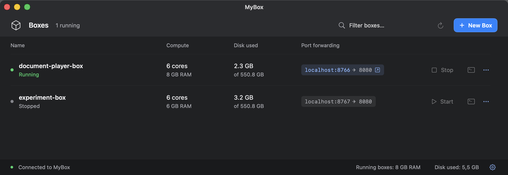
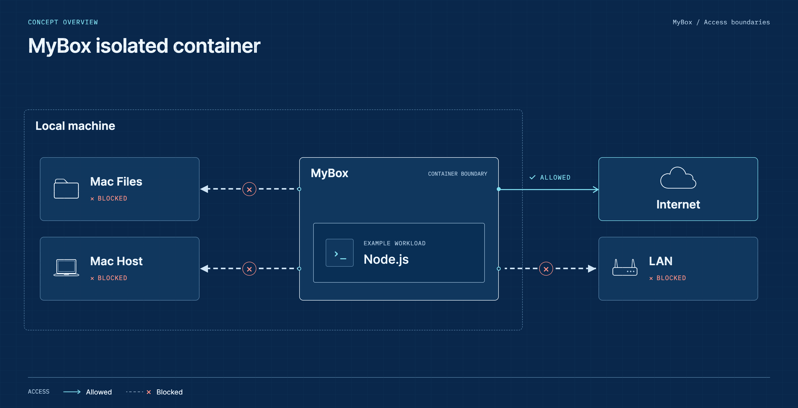
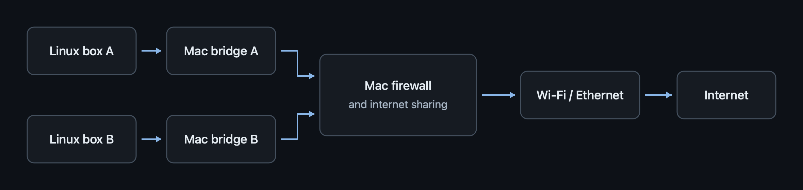
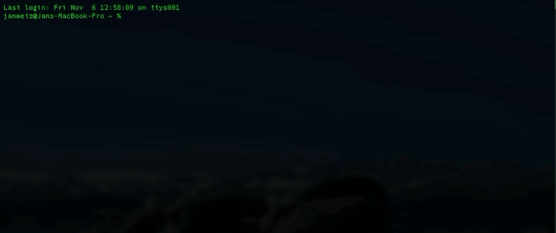

# MyBox

MyBox is an app for running isolated Linux workspaces, built on a fork of Apple's `container`.

## Example

- Node.js inside a box cannot access files or services on your Mac.
- Apps on your Mac cannot run commands or access files inside the box without your approval.



## Install

[Download MyBox (.pkg)](https://github.com/janpmz/mybox/releases/download/v0.1.0/MyBox-0.1.0-arm64.pkg) · Apple silicon · macOS 26+

## How it works






[](docs/media/mybox-demo.mp4)

## Commands

```text
$ mybox
MyBox 0.1.0 — a small Linux workspace on your Mac

Usage: mybox <command>

  create <name> [--inside-port N --outside-port N] [--cpus N] [--memory 2g]
                         Create and start a Debian box (default: 2 CPUs, --memory 2g).
                         --inside-port: server port inside the Linux box.
                         --outside-port: localhost port on your Mac.
                         Repeat both flags for multiple TCP port mappings;
                         pair the first inside port with the first outside port.
  enter <name>           Start if needed and open Bash in /workspace.
                         Accept a unique part of a name. Exact names take priority.
                         List matches and stop if the partial name is ambiguous.
  enter <name> -- <command> [arguments...]
                         Run a Linux command; piped input is supported.
  copy <source-name> <new-name>
                         Copy installed tools, settings, and files into a stopped box.
                         Include saved credentials. Keep the source's CPU and memory limits.
                         Use a separate network. Do not copy port mappings or running processes.
  import <name> <host-path>
                         Copy a file or whole folder to /workspace/<source-name>.
                         Never replace an existing destination.
                         Start the box if it is stopped.
                         Include all file names, including hidden files.
                         Skip symlinks and special files.
  export <name> <box-path> <new-host-path>
                         Copy a file or whole folder out of /workspace.
                         Never replace an existing destination.
                         Start the box if it is stopped.
                         Relative box paths start at /workspace. Reject links.
  start <name>           Start a stopped box, keeping its files.
  stop <name>            Stop a box, keeping its files.
  delete <name> [--yes]  Permanently delete a box and all its files. Stop it first if running.
                         Remove its port mappings and dedicated network. Ask for confirmation.
                         Use the full name; --yes skips confirmation.
  resize [name]          Choose a stopped box and enter CPU, memory, and disk values.
                         Press Enter to keep a value.
  resize <name> [--cpus N] [--memory-gb N] [--disk-size-gb N]
                         Change resources on a stopped box. Keep its files and ports.
                         Enter sizes in GB, using the macOS units for memory and storage.
                         Show available Mac resources before applying changes.
                         Memory: at least 200 MB. Disk: 128 MiB to less than 16 TiB.
                         Disk changes copy the filesystem and need temporary Mac space.
  ports add <name> --inside-port N --outside-port N
                         Add a TCP mapping without restarting a running box.
  ports remove <name> --outside-port N
                         Remove a MyBox mapping without restarting the box.
  ports list <name>      Show saved mappings and forwarding status.
  list [--json]          List boxes created by this CLI, including stopped ones.
                         Show CPU cores, memory, disk use, disk capacity, and ports.
                         --json: structured data with numeric sizes in bytes.
  setup-service          Install the private MyBox account and register its service.
  setup-network          Install the PF helper and automatic Mac startup setup.
  completion zsh         Print the zsh script for Tab completion.
  help                   Show this help.
  --version              Show the MyBox version.

No host folders, project disks, or SSH agents get mounted.
Each box connects to its own virtual network. MyBox checks the firewall rules before starting Linux.
Run setup-service once in a Mac terminal. PF changes require administrator access.
```

## Build from source

To build an installer locally, run `make package`.
See the [package build instructions](packaging/README.md).

Build the desktop app with `make desktop` and open it with `make desktop-run`.

For source-based development, use this checkout. Requires an Apple silicon Mac,
the Swift compiler, and the `janpmz/my-container-box` fork of Apple's `container`
installed in `/Library/Application Support/MyBox/Runtime` (version `1.6.1-mybox.5`
or later). Apple's original `container` can remain installed in `/usr/local`.

Run from this project folder:

```sh
make build
sudo ln -s "$PWD/mybox" /usr/local/bin/mybox
sudo ln -s "$PWD/my-container" /usr/local/bin/my-container
mybox setup-service
```

Skip each link command if that command is already on your `PATH`. Keep this project
folder in place because the command links to it. Setup asks for your Mac password.

`my-container` invokes the fork's full CLI directly, for example
`my-container --version` or `my-container list --all`. It runs in your normal
Mac account. Use `mybox` for boxes owned by the private `_mybox` account.
The commands use separate runtimes and stores:

- `container`: Apple's original installation and your existing Apple containers.
- `my-container`: the fork, with its own services and personal container store.
- `mybox`: the fork running as `_mybox`, with private MyBox disks.

To migrate this development Mac from the older shared fork installation, see
[runtime migration](docs/guide.md#runtime-migration).

See the [guide](docs/guide.md) for usage details and technical notes.
